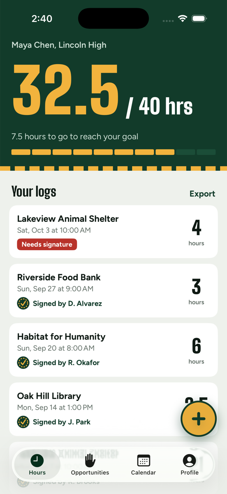
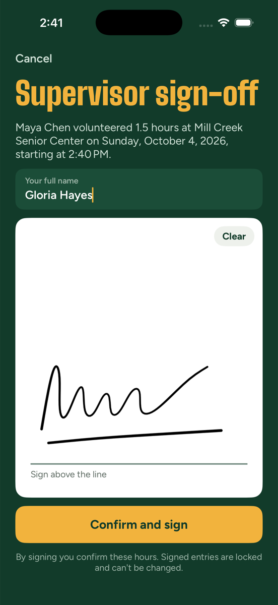
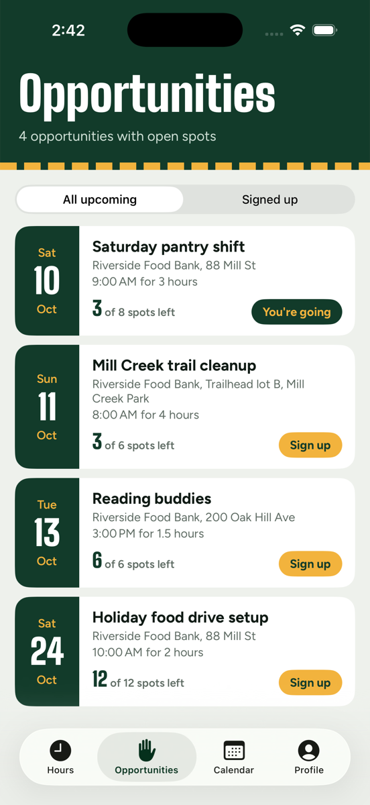
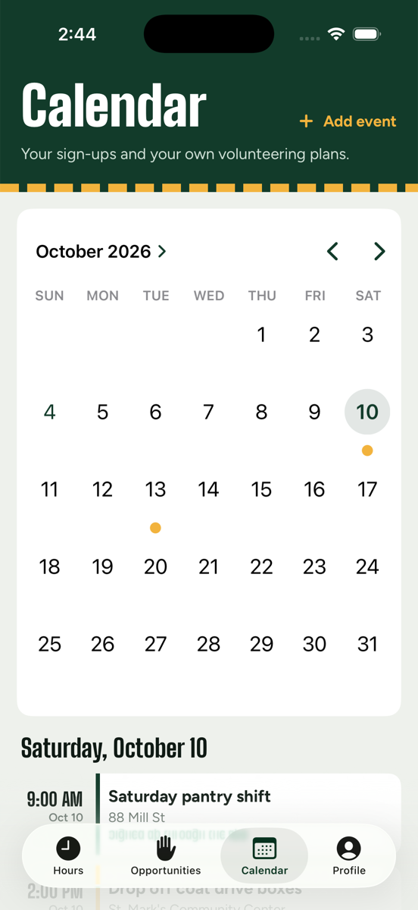
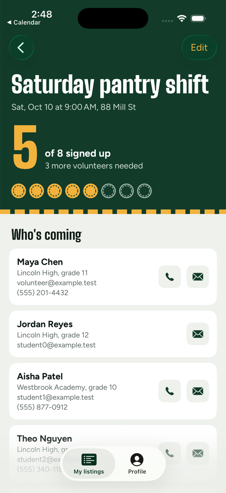

# Hour Tracker

An iPhone app for high-school students to log volunteer hours, get each entry signed on-screen by the supervisor, find volunteer opportunities posted by local organizations, and keep it all on a calendar that syncs to the iPhone Calendar app.

<p>
  
  
  
  
  
</p>

## What it does

**Students (volunteers)**
- Log hours: place, address, date and start time, hours, comments.
- **Supervisor signature:** a full-screen sign-off where the person in charge types their name and signs with a finger. Signed entries are locked so they stay trustworthy.
- Works with no signal: entries (including signatures) are saved on the phone and upload by themselves later.
- Track progress toward an hours goal (e.g. a 40-hour graduation requirement).
- **Export** every log to an Excel spreadsheet with the signature images embedded, to send to a school.
- Browse opportunities, see how many spots are left, sign up or cancel.
- Calendar of sign-ups plus your own entries, synced to a "Volunteering" calendar in the iPhone Calendar app.

**Organizations (operators)**, after the admin approves them
- Post opportunities with address, time, length and how many people are needed.
- See who's coming with their contact details, and how many more people are needed.

**Privacy:** students' personal details and signatures are encrypted in the database, and organizations only see contact details of students who signed up for their own listings. See [docs/PRIVACY.md](docs/PRIVACY.md).

## Getting started

**New here? Start with [FIRST_SETUP.md](FIRST_SETUP.md).** It goes step by step from nothing to the server on your VPS, the app on your iPhone, and friends testing through TestFlight.

| I want to… | Read |
|---|---|
| Set everything up the first time | [FIRST_SETUP.md](FIRST_SETUP.md) |
| Send TestFlight invites to friends | [FIRST_SETUP.md, Part E](FIRST_SETUP.md#part-e-testflight-invites-for-your-friends) |
| Approve an organization, back up, update, fix a problem | [docs/MAINTENANCE.md](docs/MAINTENANCE.md) |
| Know what data is stored and who sees it | [docs/PRIVACY.md](docs/PRIVACY.md) |
| Understand how it works | [docs/ARCHITECTURE.md](docs/ARCHITECTURE.md) |

Quick local run (after downloading PocketBase, see [FIRST_SETUP.md](FIRST_SETUP.md#a1-download-pocketbase-for-your-mac)):

```bash
cd server && ./dev.sh                  # terminal 1
cd server && python3 dev_seed.py       # terminal 2, demo data
open HourTracker.xcodeproj             # then press Run
```

## Project layout

```
HourTracker/          iOS app (SwiftUI)
HourTracker.xcodeproj generated from project.yml by XcodeGen
project.yml           app name, bundle id, iOS version, permissions
server/
  pb_migrations/      database tables + security rules
  pb_hooks/           encryption, sign-up limits, signature checks
  pb_public/          public web pages (privacy policy)
  smoke_test.py       automated security checks
  dev.sh, dev_seed.py local test server + demo data
  pocketbase.service, Caddyfile, pb.sh   VPS deployment files
FIRST_SETUP.md        start here
docs/                 maintenance, privacy, architecture, designs, screenshots
```

## Name ideas

"Hour Tracker" is a placeholder. Some ideas for a real name:

- **Signoff**: the moment that matters, the supervisor signing.
- **Tally**: counting up your hours.
- **Pitch In**: friendly and about the doing.
- **Letterman**: matches the design (earning your letter).
- **Logged**: short and clear.

To rename, change `CFBundleDisplayName` in `project.yml`, run `xcodegen`, and update the title on the sign-in screen (`HourTracker/UI/AuthView.swift`).

## Design

Three directions were prototyped (`docs/designs/`). **B · Letterman** was chosen: forest green and varsity gold, with big condensed numbers and a stitched "patch" for signed hours.

Fonts: [Big Shoulders Display](https://fonts.google.com/specimen/Big+Shoulders+Display) and [Figtree](https://fonts.google.com/specimen/Figtree), both under the SIL Open Font License (license files in `HourTracker/Fonts/`).
